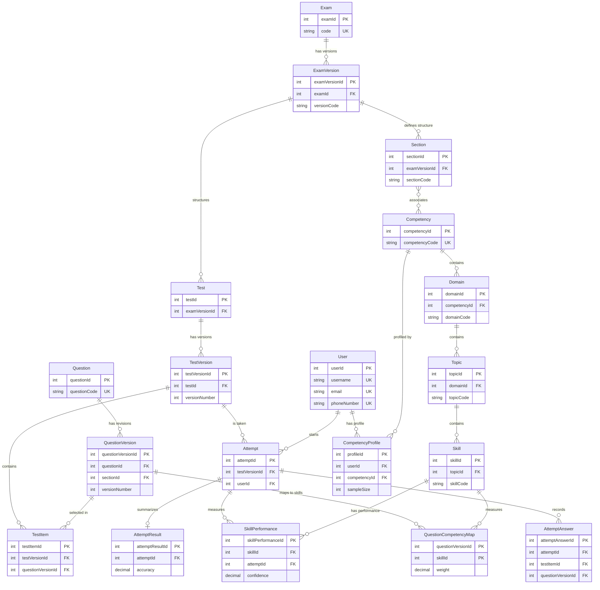

# Data Architecture & Persistence Layer

The primary persistent store is PostgreSQL, initialized from a checked-in SQL schema; backend access is a mix of Spring JDBC and a small JPA identity model. The assessment schema separates exam, question, test, attempt, and analytics records, but does not yet version taxonomy definitions.

## Database Configuration

| Service/Module | DB Type | Profile | Driver | Connection | Migration Tool |
| --- | --- | --- | --- | --- | --- |
| Backend | PostgreSQL | application defaults with environment-overridable connection settings; no distinct DB profiles found | PostgreSQL JDBC | PostgreSQL database `smart_assessment_ai`; credentials remain environment-configured | Checked-in SQL initialization and ordered SQL migration files; no Flyway/Liquibase dependency or runner configuration found in inspected backend |
| Crawler / Question Processing | File-based JSON, CSV, and question-bank snapshots; no database connection found in inspected modules | N/A | N/A | Repository artifacts | N/A |

For a new database, `database/smart_assessment_ai.sql` is the schema source. For an existing database, `database/README.md` lists `V001__add_phone_number_to_users.sql` then `V002__allow_email_or_phone_registration.sql`. Backend JPA schema handling validates rather than generates DDL. See the configuration inventory for the full property list.

## Data Ownership per Service

| Service | Tables Owned | ORM Framework | Caching | Notes |
| --- | --- | --- | --- | --- |
| Backend Identity | `users`, `roles`, `user_roles`, `classes`, `class_members` | Spring Data JPA for identity entities; JDBC for other reads | No caching annotations/provider found | Identity and class data in the shared PostgreSQL schema |
| Backend Framework | `exams`, `exam_versions`, `sections`, `section_competencies`, `competencies`, `domains`, `topics`, `skills` | Spring JDBC / `JdbcTemplate` | No caching found | Read repository returns current hierarchy rows; no taxonomy release filter |
| Backend Dashboard | Read-only aggregation over `attempts`, `attempt_results`, `tests`, `questions`, identity/class tables | Spring JDBC / `JdbcTemplate` | No caching found | Aggregates current stored results; not a versioned analytics history |
| Crawler / Question Processing | File artifacts; database ownership not found | Python JSON/CSV processing | No cache layer found | Question Bank publisher emits immutable JSON and a publication manifest; does not persist to PostgreSQL |

## Entity Model

The assessment schema's important FK path binds a Test Item to a Test Version's Test Section and a fixed Question Version; an Attempt binds to a Test Version; Attempt Answers use composite FKs to bind back to the same Test Version, Test Item, and Question Version. No taxonomy release currently participates in these relations.

<!-- mermaid-checked: every attribute is `<type> <name> [<key>] ["<description>"]` with at most one of PK/FK/UK, no \n in descriptions, no {} in descriptions, every relationship label is double-quoted -->

The diagram is a core view rather than a complete rendering of every schema table. Entity classes in the inspected Java identity module map to selected identity tables; the assessment framework repository uses DTO row mappers rather than JPA entities. No relationship mutation helper/bidirectional JPA association was found for the framework model. Backend transactions and version immutability enforcement were not established for assessment writes in the inspected modules.

## Key Repository Methods

| Service | Repository | Notable Methods | Purpose |
| --- | --- | --- | --- |
| Backend Framework | `CompetencyFrameworkRepository` | `findExams()`, `findExamVersions(examId)`, `findSections(examVersionId)`, `findCompetenciesBySection(sectionId)`, `findDomains(competencyId)`, `findTopics(domainId)`, `findSkills(topicId)` | Direct JDBC read queries for the framework hierarchy; methods are individual parent-based lookups, not bulk aggregation methods. |
| Backend Dashboard | `DashboardService` | SQL aggregations for attempts and accuracy; class/student aggregation; user/test counts | Direct JDBC dashboard summaries. Student accuracy reads the current `attempt_results` row for each attempt. |
| Backend Identity | Spring Data repositories under `identity/repository` | JPA CRUD plus existing account/role finders | Identity and role lookup; not involved in taxonomy release reads. |

## Caching Strategy

No cache provider, Spring Cache annotations, Redis, Caffeine, TTL, or second-level Hibernate cache configuration was found in the inspected backend code and resources. Framework reads execute direct SQL on each request. Do not introduce caching as part of taxonomy provenance; if added later, cache keys must include the immutable Taxonomy Release identity rather than only a Skill ID or display label.

## Data Ownership Boundaries

The checked-in DDL is one shared PostgreSQL schema organized by table groups, not database-per-service. The backend is a modular monolith; current Framework and Dashboard code query this shared database directly through `JdbcTemplate`. Crawler taxonomy, review, and published question bank artifacts are file-based and are not synchronized into the database by the inspected publisher. Existing analytics rows join back to current global Skill/Competency records, so that read path is not sufficient to reconstruct historical taxonomy meaning.

Taxonomy Release provenance recommendations and migration constraints are documented in [taxonomy_persistence_design.md](../../../../../crawler/taxonomy/review/integration/taxonomy_persistence_design.md). The current database DDL has no Taxonomy Release tables or release ID columns.

### Data Classification & Sensitivity

| Entity | Sensitive Fields | Classification (PII/PHI/PCI/None) | Controls in Place |
| --- | --- | --- | --- |
| `users` | `username`, `email`, `phone_number`, `password_hash`, `full_name` | PII and authentication secret | Password is stored as a hash. No field-level encryption or masking is evident in the inspected DDL; access control is handled in backend security configuration. |
| `attempts`, `attempt_answers`, `attempt_results`, `skill_performances`, `competency_profiles` | User-linked responses, scores, competency/profile data | Education/assessment data linked to a user; not PHI or PCI in the schema | User IDs provide relational linkage; no field-level masking or encryption declaration in the DDL was found. |
| Taxonomy and question content | Taxonomy labels, question stems, explanations, mapping evidence | None by schema alone; source content may have separate licensing/sensitivity rules | No row-level classification fields found in the audited tables. |
