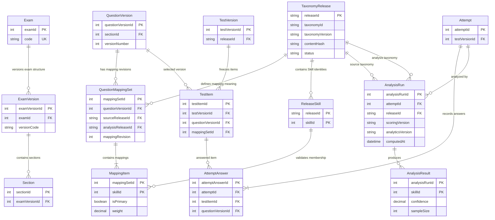

# Taxonomy Release Persistence & Integration Design — CF-03.4C

This design audits the checked-in PostgreSQL DDL and current repository code; it does not inspect or alter a running database. The schema has distinct exam, question, test, attempt, and analytics records, but taxonomy definitions and mappings are not scoped to a release.

## Current persistence audit

| Area | Current DDL | Provenance and constraints |
| --- | --- | --- |
| Exam version | `exam_versions` has `exam_id`, `version_code`, year, status, and effective dates; `(exam_id, version_code)` is unique and the parent exam is `ON DELETE RESTRICT`. | `sections.exam_version_id` is an FK with `ON DELETE CASCADE`; `tests.exam_version_id` is an FK with `ON DELETE RESTRICT`. It versions exam structure, not competency definitions. |
| Competency hierarchy | `competencies` is global with unique `competency_code`; `section_competencies` joins sections to competencies by composite PK. `domains.competency_id`, `topics.domain_id`, and `skills.topic_id` are FKs. | Domain, Topic, and Skill codes are unique only within their parent. The hierarchy has no taxonomy release FK or versioned definitions. Parent deletions cascade for the hierarchy. |
| Question version | `question_versions` includes `question_id`, `section_id`, `version_number`, content, review status, and `is_latest`; `(question_id, version_number)` is unique. Its question FK cascades, section FK restricts, passage FK sets null. | A partial unique index allows only one latest version per logical question. There is no taxonomy version or release reference. No DDL trigger prevents editing a published/approved question version. |
| Question-to-Skill mapping | `question_competency_map` has composite PK `(question_version_id, skill_id)`, FKs to Question Version (`ON DELETE CASCADE`) and Skill (`ON DELETE RESTRICT`), primary flag and optional weight. | A partial unique index allows one primary mapping per Question Version. The design has no mapping revision/batch ID and no release identity; replacing rows would erase the prior mapping interpretation. |
| Test version and items | `tests` references one `exam_version`; `test_versions` is unique by `(test_id, version_number)` and has status and latest flag. `test_items` references Question Version and uses a composite FK to `(test_section_id, test_version_id)` in `test_sections`. | Unique `(test_item_id, test_version_id, question_version_id)` supports downstream composite references. A partial unique index allows one latest Test Version. No taxonomy release is stored. The DDL does not ensure the Question Version section matches the Test Item's section. |
| Attempt and answers | `attempts` references a Test Version and user, with unique `(user_id, test_version_id, attempt_number)` and unique `(attempt_id, test_version_id)`. | `attempt_answers` ties `(attempt_id, test_version_id)` to the attempt and `(test_item_id, test_version_id, question_version_id)` to a Test Item. This already protects attempt/test/question context. Selected options are tied to the answer and Question Version and to options from that Question Version. |
| Attempt/section/question results | `attempt_results` is one row per attempt (`attempt_id UNIQUE`). `section_results` is unique by attempt and Test Section. `question_results` is unique by attempt and Test Item and separately references an optional answer. | `section_results` does not prove that its Test Section belongs to the Attempt's Test Version. `question_results` has no composite FK proving that its Test Item belongs to the same Test Version as its Attempt, nor that its answer belongs to the same Attempt/Test Item. |
| Skill performance | `skill_performances` references user, Skill, and Attempt; unique `(user_id, skill_id, attempt_id)`. It stores counts, accuracy, mastery, confidence, and calculation time. | It has no taxonomy release, mapping revision, scoring version, or analytics version. The FK to a mutable global Skill does not freeze that Skill's definition; a second analysis of the same Skill/Attempt also conflicts with the unique key. |
| Competency profile | `competency_profiles` references user and global Competency; unique `(user_id, competency_id)`. It stores scores, `sample_size`, confidence, trend, and calculation time. | It is a latest/current projection, not a historical series; no release, scoring, or analytics version is recorded. |

Relevant indexes include hierarchy parent indexes; Question Version question/section indexes; mapping Skill index and the one-primary partial unique index; Test Item test, section and question indexes; attempt and answer context indexes; and analytics user/Skill/attempt indexes. Several indexes repeat a leading column already covered by a primary/unique key, so any new index should be justified from query plans rather than copied mechanically.

The only checked-in migration files are `V001__add_phone_number_to_users.sql` and `V002__allow_email_or_phone_registration.sql`; the database README instructs applying them in order. They affect registration only. No taxonomy migration or evidence of an enabled migration runner was found in the inspected backend configuration. These findings are from checked-in files, not a live PostgreSQL catalog.

## Application and publisher audit

- The Python `QuestionBankPublisher` requires the in-memory framework to be approved and validates mappings, but its publication manifest records an exam, question count, publisher, timestamp, and question-bank SHA-256 only. It does not record `taxonomy_id`, `taxonomy_version`, `release_id`, or mapping-set identity.
- `QuestionMapper` loads the working `competency_framework.json` and validates taxonomy IDs and hierarchy relationships in memory. It does not bind mappings to a release.
- The existing Spring framework repository reads the global hierarchy directly with `JdbcTemplate`; Skill/Competency reads are not release-filtered. The inspected backend has no Question Bank, Attempt, Scoring, or Competency Analytics persistence module.
- `DashboardService` currently aggregates a student's average from the single `attempt_results` row per attempt. That is a view of current stored values, not versioned analysis history.
- No Taxonomy Release identifier, scoring version, or analytics version is present in the audited DDL.

## Selected persistence approach

Persist the release identity and immutable manifest metadata in a small relational catalog, while keeping the canonical taxonomy content in the immutable snapshot referenced by the manifest. Do not duplicate every taxonomy label and description into a second mutable table set. A normalized release-to-Skill membership relation is still needed so mapping rows can be constrained to Skills included in the referenced release.

For Question mapping, choose **Option B at the mapping-set level**: one immutable mapping-set header binds one Question Version to exactly one Taxonomy Release; all mapping rows belong to that header. This avoids repeating a release ID on every Skill row while ensuring that the mapping set cannot mix releases. A new mapping set is created for a changed mapping or re-analysis; old sets are retained. Keep the existing `question_competency_map` rows as legacy until evidence-based migration is approved.

For a published Test Version, the default policy is one Taxonomy Release across its included Question Version mapping sets. Each Test Item selects the mapping set used for that test. Composite keys/FKs should enforce that the selected set matches the Question Version and the Test Version's release. This preserves a single coherent interpretation for the test while allowing a later re-analysis to explicitly use another release. If mixed-release tests are a required product behavior, that is a separate decision and must replace this default invariant.

### Proposed persistence entities

These names are design proposals only; none of these tables or columns exists in the current database.

| Proposed entity | Minimum responsibility |
| --- | --- |
| `taxonomies` | Stable logical `taxonomy_id` and descriptive identity. |
| `taxonomy_releases` | Unique `release_id`, taxonomy/version, parent release, release status, snapshot content hash, immutable manifest, snapshot locator, publication time. Enforce unique `(taxonomy_id, taxonomy_version)` and unique `release_id`; parent is a self-FK. Approval decision references stay in the manifest unless the organization selects a relational approval store. |
| `taxonomy_release_events` | Append-only publish/retire/supersede audit events with actor, event time, reason, and evidence reference. Do not update historical event rows. |
| `taxonomy_release_skills` | Release membership for a stable Skill ID; composite unique key `(taxonomy_release_id, skill_id)` makes a release's Skill set referentially checkable. Historical definitions resolve from the immutable snapshot. |
| `question_mapping_sets` | Immutable revision header for `(question_version_id, mapping_revision)` with one `taxonomy_release_id` and state/publication metadata. |
| `question_mapping_set_items` | Skill, primary flag, and weight under one mapping-set header. Its FK targets release membership, not the mutable current Skill definition. |
| `attempt_analysis_runs` | One immutable scoring/analytics execution for an Attempt, recording source Test Version release, analysis release, scoring version, analytics version, run kind, computed time, input provenance, and optional superseded run. |
| Versioned analysis result rows | Result values keyed by an analysis run; Skill/Competency references are checked against that run's analysis release. Existing single-row result tables are not rewritten to manufacture versions. |

`taxonomy_releases.manifest` should retain the validated release manifest (including approval refs and source artifact hashes); the snapshot itself can remain in the approved immutable file/object store, identified by a stable locator and SHA-256. Selecting durable database/object-store retention and access controls is a prerequisite to relying on that locator operationally.

<!-- mermaid-checked: every attribute is `<type> <name> [<key>] ["<description>"]` with at most one of PK/FK/UK, no \n in descriptions, no {} in descriptions, every relationship label is double-quoted -->

This diagram shows the proposed logical provenance path. Current database edges that already exist are described in the audit table above; the release and analysis entities are not yet implemented.
